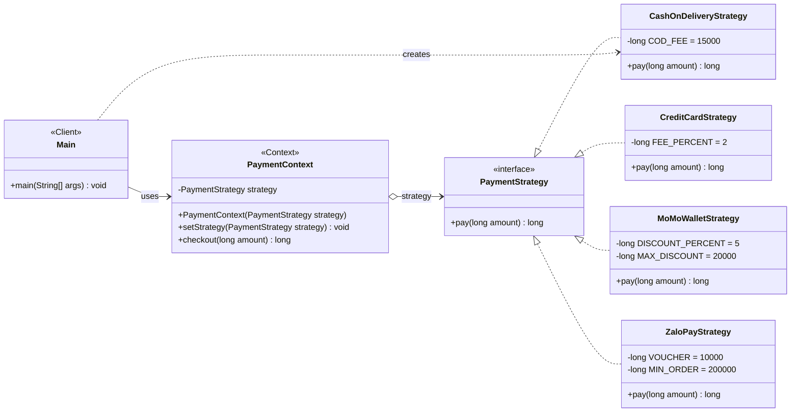
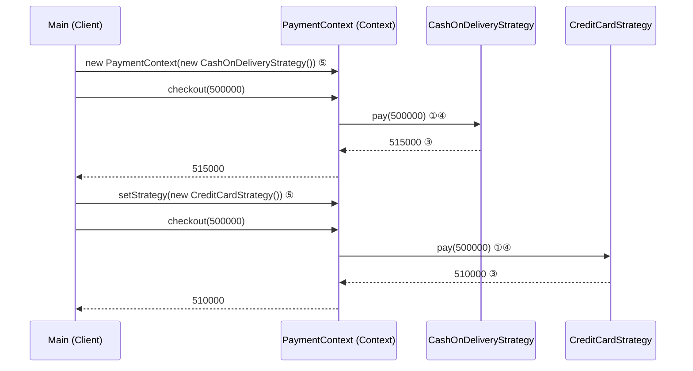

# Strategy Pattern — Java Case Study (Thanh toán khi checkout)

> Nhóm: Behavioral Patterns · Pattern 21/23 trong deck · Ngôn ngữ: Java 17+ (đã chạy thử trên JDK 21)

## 1. Ý tưởng trong một câu

**Strategy** định nghĩa một *họ thuật toán*, đóng gói mỗi thuật toán vào một class riêng
và cho phép **hoán đổi chúng lúc runtime** mà không phải sửa class đang dùng thuật toán đó.

**Bài toán demo:** một shop online có đơn hàng 500.000 VND. Khách chọn cách thanh toán,
mỗi cách tính tổng tiền khác nhau:

| Cách thanh toán | Quy tắc | Tổng tiền |
|---|---|---|
| COD (tiền mặt khi nhận hàng) | + 15.000 phí thu hộ | 515.000 |
| Thẻ tín dụng | + 2% phí thẻ | 510.000 |
| Ví MoMo | − 5%, tối đa 20.000 | 480.000 |
| ZaloPay (thêm sau) | − 10.000 nếu đơn ≥ 200.000 | 490.000 |

---

## 2. Vấn đề khi KHÔNG dùng pattern (slide "Problem")

File: [before/CheckoutWithoutPattern.java](src/com/swd392/strategy/before/CheckoutWithoutPattern.java)

```java
public long checkout(long amount, String method) {
    if ("COD".equals(method)) {
        return amount + 15_000;
    } else if ("CARD".equals(method)) {
        return amount + amount * 2 / 100;
    } else if ("MOMO".equals(method)) {
        return amount - Math.min(amount * 5 / 100, 20_000);
    } else {
        throw new IllegalArgumentException("Unsupported payment method: " + method);
    }
}
```

Nhược điểm:

- **Vi phạm Open/Closed Principle:** thêm ZaloPay thì phải **sửa** class này, thêm một nhánh `else if`.
- Class phình to dần, mọi quy tắc thanh toán dồn vào một chỗ.
- Sửa một nhánh có thể làm hỏng nhánh khác. Mỗi lần sửa phải test lại toàn bộ class.
- Không đổi được cách tính khi đang chạy, trừ khi truyền chuỗi `method` đi khắp nơi.

---

## 3. Class diagram

### 3.1 Diagram gốc (giống slide Strategy trong deck)

```
                             strategy
 +--------------------------+         +--------------------------+
 | Context              (1) |<>------>| <<interface>>        (2) |
 |--------------------------|         | Strategy                 |
 | - strategy: Strategy     |         |--------------------------|
 | + setStrategy(strategy)  |         | + execute(data)          |
 | + doSomething()      (4) |         +--------------------------+
 +--------------------------+                       ^
              ^                                     : implements
              | uses                                :
 +--------------------------+         +--------------------------+
 | Client               (5) |-------->| ConcreteStrategies   (3) |
 +--------------------------+ creates | + execute(data)          |
                                      +--------------------------+

 (4) doSomething() { strategy.execute(data); }
```

### 3.2 Diagram của code Java (Mermaid, GitHub/VS Code tự render)



Bản PlantUML để xuất ảnh đưa lên slide: [diagram/strategy-class-diagram.puml](diagram/strategy-class-diagram.puml).
Dán nội dung file vào https://www.plantuml.com/plantuml hoặc dùng extension PlantUML trong VS Code / IntelliJ.

### 3.3 Đọc các mũi tên UML (câu hay bị hỏi)

| Ký hiệu | Tên | Ý nghĩa trong code |
|---|---|---|
| `◇──▶` (kim cương rỗng) | Aggregation | `PaymentContext` **giữ** một field `PaymentStrategy`, nhưng strategy có thể tồn tại độc lập và được thay bằng cái khác |
| `- - -▷` (nét đứt, tam giác rỗng) | Realization | `CashOnDeliveryStrategy implements PaymentStrategy` |
| `──▶` (nét liền) | Association | `Main` dùng `PaymentContext` |
| `- - ->` (nét đứt, mũi tên mở) | Dependency | `Main` chỉ **tạo** (`new`) concrete strategy, không giữ field |

---

## 4. Bảng ánh xạ: vai trò trong diagram ↔ class Java

| Vai trò trong diagram | Class Java | File |
|---|---|---|
| **Context** | `PaymentContext` | [PaymentContext.java](src/com/swd392/strategy/PaymentContext.java) |
| **Strategy** (interface) | `PaymentStrategy` | [PaymentStrategy.java](src/com/swd392/strategy/PaymentStrategy.java) |
| **ConcreteStrategies** | `CashOnDeliveryStrategy`, `CreditCardStrategy`, `MoMoWalletStrategy`, `ZaloPayStrategy` | [CashOnDeliveryStrategy.java](src/com/swd392/strategy/CashOnDeliveryStrategy.java), [CreditCardStrategy.java](src/com/swd392/strategy/CreditCardStrategy.java), [MoMoWalletStrategy.java](src/com/swd392/strategy/MoMoWalletStrategy.java), [ZaloPayStrategy.java](src/com/swd392/strategy/ZaloPayStrategy.java) |
| **Client** | `Main` | [Main.java](src/com/swd392/strategy/Main.java) |
| `- strategy` | field `private PaymentStrategy strategy` | PaymentContext.java |
| `setStrategy(strategy)` | `setStrategy(PaymentStrategy)` | PaymentContext.java |
| `doSomething()` | `checkout(long amount)` | PaymentContext.java |
| `execute(data)` | `pay(long amount)` | PaymentStrategy.java |

`Trace.java` chỉ để in log ra terminal. Class này **không** thuộc pattern, không cần đưa lên diagram.

---

## 5. Giải thích code theo 5 điểm đánh số trên diagram

Các số ①–⑤ trùng với số trên hình Strategy trong deck (hình của refactoring.guru).

### ① Context giữ tham chiếu tới một strategy

```java
public class PaymentContext {
    private PaymentStrategy strategy;          // kiểu là INTERFACE, không phải class cụ thể

    public PaymentContext(PaymentStrategy strategy) {
        this.strategy = strategy;
    }
```

Điểm mấu chốt: field có kiểu `PaymentStrategy` (interface). Context không biết, và không cần biết,
object bên trong là COD, thẻ hay MoMo.

### ② Strategy interface — "hợp đồng" chung

```java
public interface PaymentStrategy {
    long pay(long amount);
}
```

Mọi thuật toán thanh toán phải có cùng một method `pay`. Nhờ vậy Context gọi được
bất kỳ strategy nào theo một cách duy nhất.

### ③ Concrete Strategies — mỗi class là một thuật toán

```java
public class CashOnDeliveryStrategy implements PaymentStrategy {
    private static final long COD_FEE = 15_000;

    @Override
    public long pay(long amount) {
        return amount + COD_FEE;               // (bản demo có thêm dòng log)
    }
}
```

Bốn class, bốn quy tắc tính tiền, mỗi class nằm trong file riêng. So với bản `if/else`:
mỗi nhánh `if` giờ thành **một class**.

### ④ Context gọi strategy qua interface (delegation)

```java
public long checkout(long amount) {
    return strategy.pay(amount);               // ủy quyền (delegate) cho strategy
}
```

`checkout` **không có** `if/else` nào. Thêm bao nhiêu cách thanh toán thì method này vẫn giữ nguyên.

### ⑤ Client chọn strategy và có thể đổi lúc runtime

```java
PaymentContext context = new PaymentContext(new CashOnDeliveryStrategy());
context.checkout(500_000);                     // 515,000

context.setStrategy(new CreditCardStrategy()); // đổi thuật toán khi đang chạy
context.checkout(500_000);                     // 510,000
```

Client (`Main`) là nơi **duy nhất** biết class cụ thể. Context chỉ nhận strategy được truyền vào.

---

## 6. Dynamic execution tracing (luồng chạy)



### Chạy demo

```bash
./design-pattern/strategy/run.sh
```

Trên Windows PowerShell:

```powershell
.\design-pattern\strategy\run.ps1
```

### Output thật (đã chạy trên JDK 21)

```
=== Strategy Pattern demo: checkout payment ===
Order amount: 500,000 VND

--- 1) Customer picks Cash on Delivery ---
  [Client]           #5     context = new PaymentContext(new CashOnDeliveryStrategy())
  [Context]          #1 #4  checkout(500,000 VND) -> strategy.pay(amount)
  [ConcreteStrategy] #3     CashOnDeliveryStrategy.pay(): 500,000 VND + 15,000 VND COD fee = 515,000 VND
  [Client]                  customer pays 515,000 VND

--- 2) Customer switches to Credit Card at runtime ---
  [Client]           #5     context.setStrategy(new CreditCardStrategy())
  [Context]          #1 #4  checkout(500,000 VND) -> strategy.pay(amount)
  [ConcreteStrategy] #3     CreditCardStrategy.pay(): 500,000 VND + 2% card fee (10,000 VND) = 510,000 VND
  [Client]                  customer pays 510,000 VND

--- 3) Customer switches to MoMo wallet ---
  [Client]           #5     context.setStrategy(new MoMoWalletStrategy())
  [Context]          #1 #4  checkout(500,000 VND) -> strategy.pay(amount)
  [ConcreteStrategy] #3     MoMoWalletStrategy.pay(): 500,000 VND - 5% off, max 20,000 VND (20,000 VND) = 480,000 VND
  [Client]                  customer pays 480,000 VND

--- 4) ZaloPayStrategy added later - PaymentContext unchanged (Open/Closed) ---
  [Client]           #5     context.setStrategy(new ZaloPayStrategy())
  [Context]          #1 #4  checkout(500,000 VND) -> strategy.pay(amount)
  [ConcreteStrategy] #3     ZaloPayStrategy.pay(): 500,000 VND - 10,000 VND voucher (order >= 200,000 VND) = 490,000 VND
  [Client]                  customer pays 490,000 VND
```

Mỗi dòng có tag vai trò (`[Client]`, `[Context]`, `[ConcreteStrategy]`) và số trên diagram (`#1`–`#5`).
Khi thuyết trình, chụp màn hình output rồi chỉ từng dòng tương ứng với số trên class diagram.

Lưu ý: dòng log của Context **không** in tên class strategy. Đây là chủ ý: Context không biết mình đang dùng strategy nào.

---

## 7. Consequences & trade-offs (ứng với mục 4 "4 GoF components" trong deck)

**Ưu điểm**

- Đổi thuật toán lúc runtime (`setStrategy`).
- Tuân thủ **Open/Closed Principle**: thêm `ZaloPayStrategy` mà không sửa `PaymentContext`.
- Tuân thủ **Single Responsibility**: mỗi class chỉ chứa một quy tắc tính tiền.
- Dùng **composition thay cho inheritance**: Context *có* một strategy, không *kế thừa* thuật toán.
- Dễ unit test từng strategy riêng.

**Nhược điểm**

- Thêm nhiều class nhỏ. Nếu chỉ có 2 thuật toán và hiếm khi đổi thì `if/else` có thể đơn giản hơn.
- Client phải biết các strategy khác nhau thế nào để chọn đúng.
- Từ Java 8, nếu strategy chỉ có một method thì có thể dùng lambda thay cho class riêng (xem mục 8).

---

## 8. Chuẩn bị Q&A

**Strategy khác State thế nào? (Hai class diagram gần như giống nhau)**
Strategy: **client** chọn thuật toán, các strategy không biết nhau.
State: các state **tự chuyển** sang state khác (`context.changeState(...)`), và state biết các state khác.

**Strategy khác Template Method thế nào?**
Template Method dùng **kế thừa**: lớp con override một vài bước, cố định lúc compile.
Strategy dùng **composition**: thay cả thuật toán bằng một object khác, đổi được lúc runtime.

**Trong JDK có Strategy không?**
Có. `Comparator` là ví dụ kinh điển: `list.sort(comparator)`. `List` là Context,
`Comparator` là Strategy, mỗi cách so sánh là một Concrete Strategy.

**Viết gọn bằng lambda được không?**
Được, vì `PaymentStrategy` chỉ có một abstract method (functional interface):

```java
context.setStrategy(amount -> amount);              // strategy "miễn phí", không phí, không giảm giá
context.setStrategy(amount -> amount * 90 / 100);   // giảm 10%
```

**Ai quyết định dùng strategy nào trong hệ thống thật?**
Thường là một Factory, một `Map<String, PaymentStrategy>`, hoặc Dependency Injection (Spring), dựa trên input của người dùng hoặc file cấu hình.

---

## 9. Strategy trong chính project Vieva (slide "real-world")

Backend Vieva đã dùng tư tưởng Strategy, kết hợp với Dependency Injection của Spring:

| Vai trò | Trong Vieva |
|---|---|
| Strategy (interface) | [`FileStoragePort`](../../BE/src/main/java/com/example/vieva/application/ports/output/FileStoragePort.java): `store`, `load`, `delete` |
| Concrete Strategy A | [`LocalFileStorageGateway`](../../BE/src/main/java/com/example/vieva/infrastructure/service/LocalFileStorageGateway.java): lưu file trên ổ đĩa |
| Concrete Strategy B | [`CloudinaryStorageGateway`](../../BE/src/main/java/com/example/vieva/infrastructure/service/CloudinaryStorageGateway.java): lưu file lên Cloudinary |
| Context | [`DocumentServiceImpl`](../../BE/src/main/java/com/example/vieva/application/usecases/document/DocumentServiceImpl.java): chỉ giữ field `FileStoragePort fileStorage` |
| Client / nơi chọn strategy | Spring + cấu hình `vieva.storage.provider=local\|cloudinary` (`@ConditionalOnProperty`) |

Các cặp tương tự trong Vieva:

- `EmailSenderPort`: `LogEmailGateway` / `SmtpEmailGateway` (`vieva.mail.provider`).
- `QuestionGenerationPort`: `MockQuestionGenerationGateway` / `GeminiLLMAdapter` (`vieva.ai.provider`).

Khác biệt với bản demo: Vieva chọn strategy **một lần khi khởi động** bằng config,
còn bản demo đổi strategy **lúc runtime** bằng `setStrategy`.
